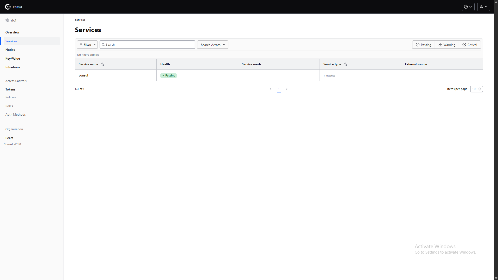
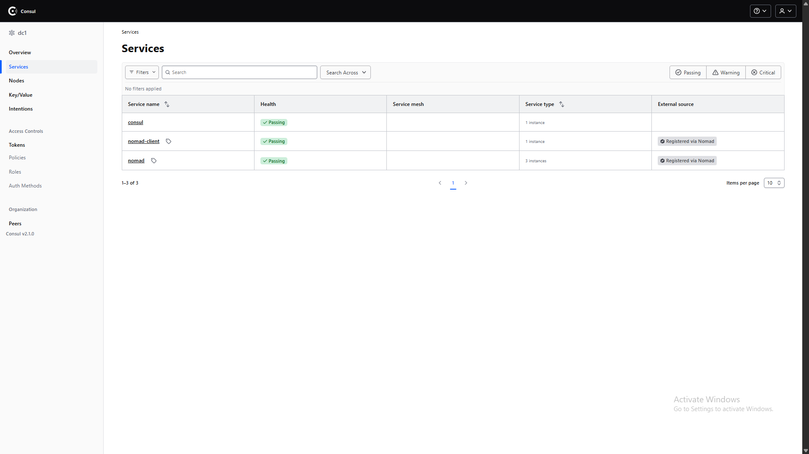
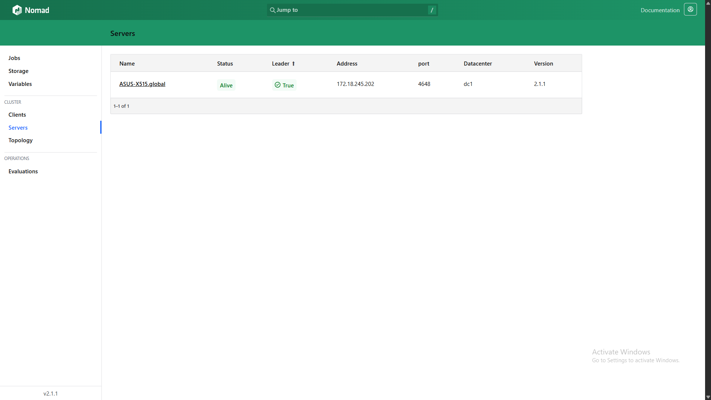
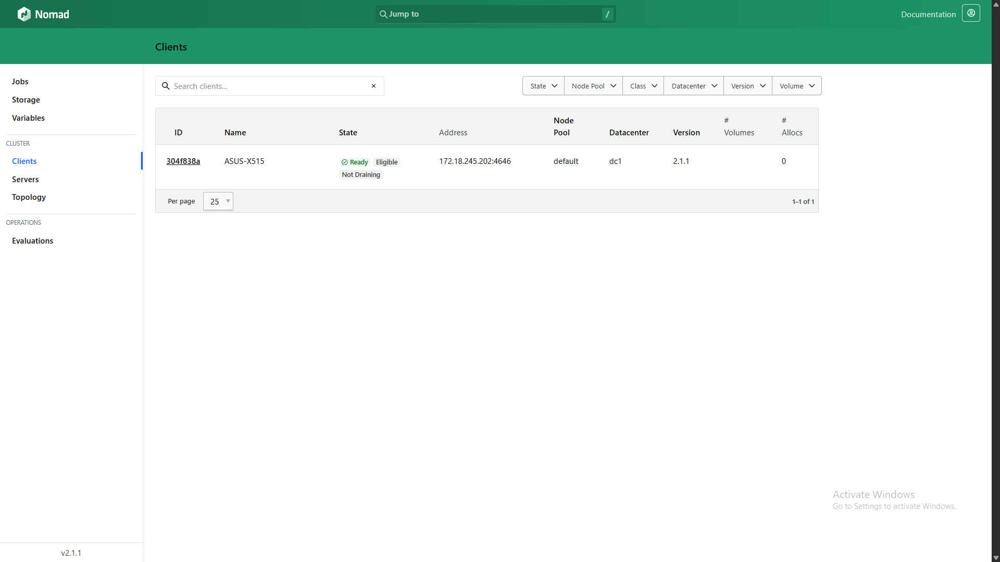
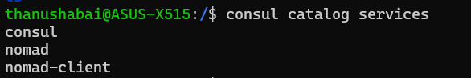

# Nomad & Consul Single-Node Infrastructure

## Overview

This repository contains the configuration files and documentation to deploy HashiCorp Nomad and Consul on a single machine. It demonstrates single-node infrastructure setup, including service discovery and orchestration integration, tested on a WSL2/Ubuntu environment.

## Features

- **Single-Node Architecture:** Nomad acts as both Server and Client to manage workloads.
- **Service Discovery:** Consul runs as a single-node server with its UI enabled.
- **Auto-Registration:** Nomad is configured to automatically register its server and client services into Consul.
- **Environment Resolutions:** Includes workarounds for WSL2 networking and systemd timeout issues to ensure a stable setup.

## Prerequisites

- A Linux environment (tested on Ubuntu via WSL2).
- Sudo privileges for installation and service management.

## Deployment Steps

### Step 1: Apply WSL2 Workaround

Apply this fix to prevent the Nomad Client from failing due to missing bridge kernel modules in WSL2:

```bash
sudo mkdir -p /lib/modules/$(uname -r)/
echo '\_/bridge.ko' | sudo tee -a /lib/modules/$(uname -r)/modules.builtin
```

### Step 2: Apply Configurations

Copy the `.hcl` configuration files from this repository to their respective system directories:

```bash
sudo cp consul.hcl /etc/consul.d/consul.hcl
sudo cp nomad.hcl /etc/nomad.d/nomad.hcl
```

### Step 3: Set Permissions

Create the data directories and assign the correct ownership:

```bash
sudo mkdir -p /opt/consul /opt/nomad
sudo chown -R consul:consul /opt/consul
sudo chown -R nomad:nomad /opt/nomad
```

### Step 4: Start Services

Enable and start both services using systemd:

```bash
sudo systemctl enable --now consul
sudo systemctl enable --now nomad
```

### Step 5: Verification

Verify that Nomad successfully registered itself with Consul by checking the catalog:

```bash
consul catalog services

# Expected Output:
# consul
# nomad
# nomad-client
```

## Architecture

- **Consul:** Manages service discovery and health checks. Runs as a single-node server.
- **Nomad:** Handles orchestration. Runs as a single-node cluster (Server + Client).
- **Integration:** The `consul` block in Nomad's configuration (`nomad.hcl`) points to the local Consul agent, enabling auto-registration.

## Proof of Work (Screenshots)

### Consul Web UI

The local `consul` service is passing health checks.



The `nomad` and `nomad-client` services are registered and passing, explicitly tagged as "Registered via Nomad".



### Nomad Web UI

The `ASUS-X515.global` server node is Alive and elected as the cluster Leader.



The `ASUS-X515` client node is Ready and Eligible to receive workloads.



### CLI Integration Verification

Terminal command `consul catalog services` confirming both Nomad server and client are successfully registered.


